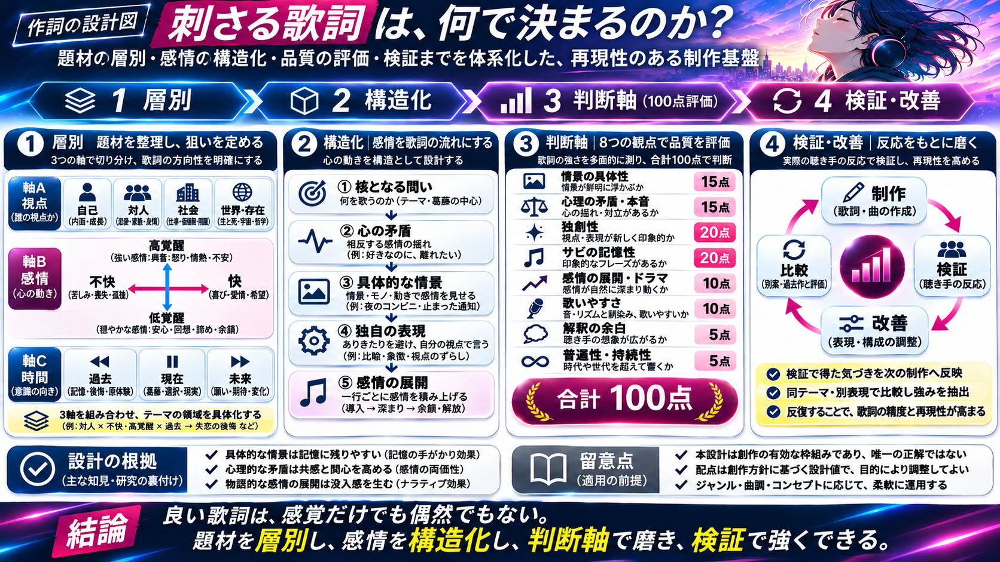
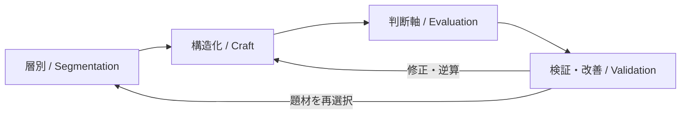

# LYRIC DESIGN FRAMEWORK

**歌詞の層別・構造化・評価・検証をつなぐ制作設計（Design / Pre-validation）**

> センスを否定しない。偶然だけに任せない。

**Maintainer:** Gacky / Gacky-Lab  
**Project status:** `Design / experimental editorial method` — 作詞支援の設計資料・採点補助ツール。実証済みのヒット予測モデルではありません。  
**Prepared:** 2026-11-24 (JST)  
**Languages:** Japanese (primary), English (summary)

> **図について:** 生成画像による概要説明です。細かな文言・配点・学術的記述は画像ではなく、本リポジトリ内のMarkdownと `config/rubric.json` を正本とします。

## Why / 何のために作るのか

歌詞を「共感する・しない」の直感だけで採点するのではなく、題材の見方、感情の変化、言葉の独自性、歌としての伝達まで、**検討可能な判断**に落とすための個人制作基盤です。

社会問題の解決を必須条件とはしません。恋愛、喜び、空想、存在への問い、ユーモア、意味の余白なども出発点になります。

## 4つの機能

| 機能 | 目的 | 成果物 |
| --- | --- | --- |
| 層別 | 何を誰の視点から描くかを整理 | 視点×感情×時間の座標 |
| 構造化 | 心の動きを歌える言葉へ落とす | 問い→揺れ→情景→一行→展開 |
| 判断軸 | 改稿箇所を特定 | 歌詞8軸の編集採点（100点） |
| 検証・改善 | 狙いと実際の反応の差を確認 | A/B統制記録、初見・再聴・翌日想起 |

**創作順序は自由です。** サビの一行から設計を逆算してもよく、楽曲により軸の優先度を変えて構いません。

## 3つの層別座標

- **視点の射程:** 自己／対人／社会／存在
- **感情状態:** 快↔不快（valence） × 高覚醒↔低覚醒（arousal）
- **時間の焦点:** 過去／現在／未来

主軸・副軸を重ねて使います。「恋愛」「怒り」「後悔」のような**異なる次元の概念を同じ分類表に混ぜない**ための設計であり、網羅的な心理学分類ではありません。詳細は [層別設計](docs/segmentation.md)。

## 歌詞の編集用100点評価

| 8軸 | 配点 |
| --- | ---: |
| 情景の具体性 | 15 |
| 心理的矛盾・本音 | 15 |
| 独創性・発見 | 20 |
| サビの強さ・記憶性 | 20 |
| 物語・感情の変化 | 10 |
| 日本語の歌いやすさ | 10 |
| 解釈の余白 | 5 |
| 普遍性 | 5 |
| **合計** | **100** |

**注意：全軸を最低の1点とした場合でも、総合は20/100点です（全軸未採点は合計なし）。** これは1〜5段階を重みづけする計算仕様で、絶対的な品質尺度ではありません。

この**配点は制作方針による編集上の選択**です。科学的な最適値でも、ヒット確率でもありません。歌詞の品質と、音源で実際に歌った際の適合性は別に評価します。詳細は [歌詞評価ルール](docs/evaluation.md) と [歌唱評価](docs/vocal_fit.md)。

## Quick start / 最初の使い方

1. [`templates/lyric-brief.template.json`](templates/lyric-brief.template.json) に題材・3軸・表現意図を記入
2. [`docs/creative_process.md`](docs/creative_process.md) に沿って歌詞を試作・改稿（順序は自由）
3. [`templates/scorecard.template.json`](templates/scorecard.template.json) に1〜5段階の仮評価を記入
4. `python scripts/scorecard.py templates/scorecard.template.json` で入力値を点検（未採点は未採点と表示）
5. 音源を聴き、[検証設計](docs/validation.md) に従って条件と結果を記録

**実際に試す例：** [架空の作詞・改稿デモ（A→B）](examples/fictional-revision/README.md) では、視点・感情・時間の層別から、歌詞の改稿・8軸仮採点・検証計画までを具体的に追えます。*数値は説明用の仮評価であり、聴取実験の成果ではありません。*

**品質チェック：** `python -m unittest discover -s tests -v`、`python scripts/check_repository.py`。`.github/workflows/quality.yml` がpush/PR時にこれらをPython 3.10と3.13で自動実行する設計です。実際のCI成功可否は[Actions](https://github.com/Gacky-Lab/LYRIC-DESIGN-FRAMEWORK/actions)で確認してください。

依存パッケージ不要。Python 3.10以上を想定した軽量な採点チェックのサンプルを同梱しています。**作詞AIモデル・音声生成エンジン自体は実装していません。**

## バージョン管理された歌詞受渡し（ローカルIF）

[Lyric Handoff v1](docs/handoff_interface.md)では歌詞原文・版ID・SHA-256・任意の編集評価を機械的に照合できるJSONとして出力します。実際のSuno/VOCALOIDへの接続・歌唱同期は実機未検証の別工程です。

## リスナー検証の層別（新規）

[テキスト比較・歌詞単独音源比較・複合音源比較を判定する事前検査](docs/STUDY_SELECTION_AND_EVIDENCE.md)を追加しました。試験計画の条件不足を検知し、聴取実測は未実施（NOT_RUN）として管理します。

## Documents

- [設計思想と役割](docs/architecture.md)
- [3軸の層別](docs/segmentation.md)
- [5要素の創作手順](docs/creative_process.md)
- [8軸の評価・採点アンカー](docs/evaluation.md)
- [歌詞と歌唱の評価分離](docs/vocal_fit.md)
- [A/B・リスナーテスト](docs/validation.md)
- [研究の参照範囲・限界](docs/research_and_limits.md)
- [公開範囲・権利・個人情報](docs/publication_and_rights.md)
- [既存AI VOCALOID STUDIOとの接続](docs/integration.md)
- [English overview](docs/english_overview.md)
- [架空の作詞・改稿デモ](examples/fictional-revision/README.md)

## Scope / 検証状況

| 項目 | ステータス |
| --- | --- |
| 層別・評価ルールの文書化 | 設計済み |
| 評価入力の静的チェック | テスト付きコード・CI定義あり（実行状況はActions参照） |
| サンプル作詞・改稿 | 架空例あり（効果の実測ではない） |
| 8軸が記憶性・ヒットに有効 | **未実証** |
| リスナーA/B比較 | **未実施** |
| Suno / VOCALOIDとの自動連携 | **未実装** |
| 商業的ヒットの予測 | **対象外** |

本プロジェクトは独立の個人研究・制作設計であり、Suno、Yamaha、Crypton、GitHubなどの公式プロジェクトではありません。

## Related project

- [Gacky-Lab/AI-VOCALOID-STUDIO](https://github.com/Gacky-Lab/AI-VOCALOID-STUDIO) — Suno素材から純正歌声合成・REAPERまでを扱う**別の技術設計**。歌詞Handoffのローカルデータ受渡しはCIで検証済み。歌詞の音符整列・音声制作の実機統合は構想段階です。

## License / 権利

**ライセンス未決定。** `LICENSE` は意図的に含めていません。GitHubで公開するだけでは再利用許諾にはなりません。再配布・外部貢献を募集する場合、公開する文書・コード・生成画像の権利を確認してライセンスを別途選定してください。 [公開時の注意](docs/publication_and_rights.md)
