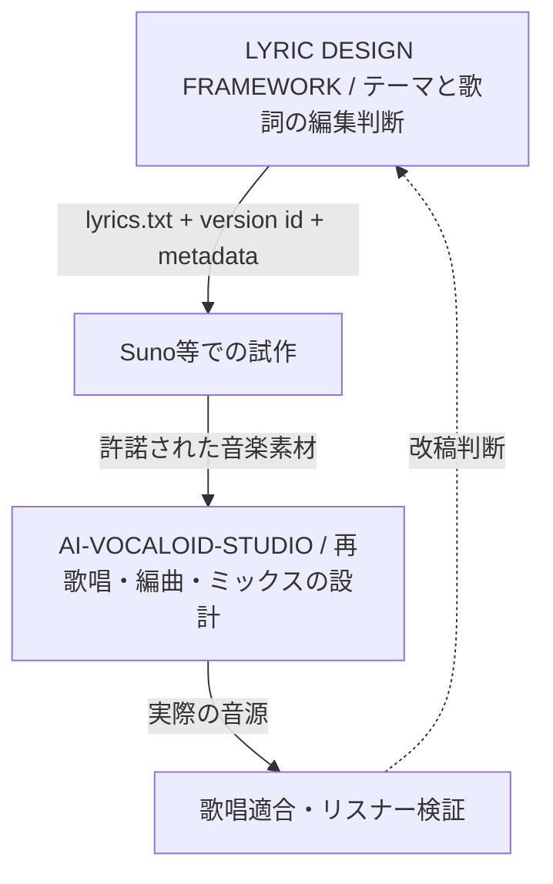

# AI-VOCALOID-STUDIOとの関係

**既存技術設計:** https://github.com/Gacky-Lab/AI-VOCALOID-STUDIO

- 本リポジトリは**何を書くか、なぜそう書くか**を扱う。
- 既存リポジトリは**どのツールで歌わせ、制作工程を通すか**を扱う。
- `lyric_version_id` と歌詞原文のハッシュを生成物に紐づけると、将来の追跡性を高められる。
- **現時点で自動インターフェースの実装・動作試験は行っていない。** 既存のSong IRとの統合は将来の設計課題である。
- Sunoのモデル出力に実際の初音ミク音源が含まれると推定しない。公式音源での再歌唱は正規の制作環境で行う。
