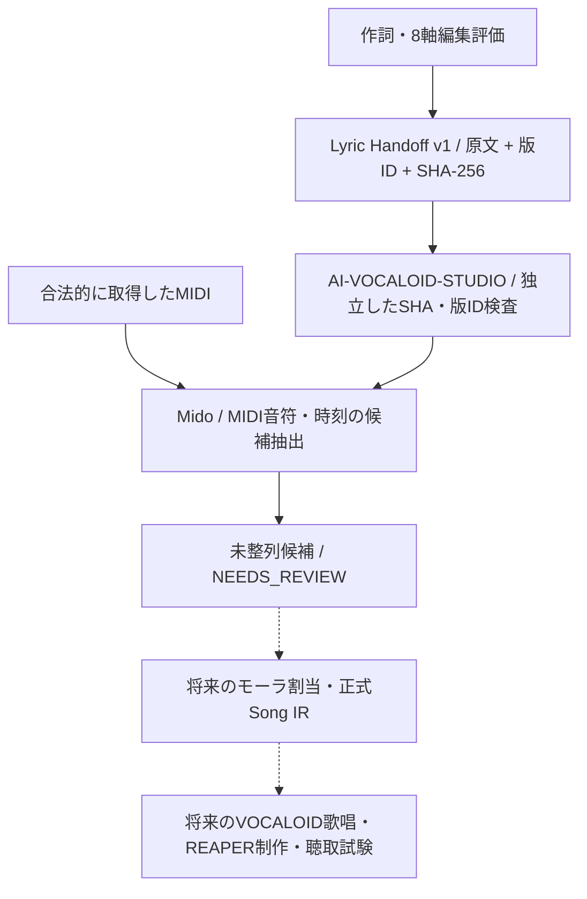

# AI-VOCALOID-STUDIOとの統合状況（2026-11-24）

**関連する制作技術プロジェクト:** https://github.com/Gacky-Lab/AI-VOCALOID-STUDIO

## データフロー

## 実装・検証済み（オフライン）

- [Lyric Handoff v1](handoff_interface.md)のエクスポーターで歌詞・version ID・SHA-256・任意の作者による編集採点を生成。
- 制作側の独立した[検証器](https://github.com/Gacky-Lab/AI-VOCALOID-STUDIO/blob/main/tools/verify_handoff.py)でバージョンと原文SHAを検査。
- 制作側の[MIDI候補生成](https://github.com/Gacky-Lab/AI-VOCALOID-STUDIO/blob/main/tools/midi_candidates.py)に歌詞版の参照情報を付与。
- [制作側GitHub Actions](https://github.com/Gacky-Lab/AI-VOCALOID-STUDIO/actions)で、両リポジトリをcheckoutした実コードによる契約結合を試験。参照する歌詞側コミットは再現性のため固定。

## まだ実装・検証していないこと

- **歌詞HandoffとMIDIの照合は原文参照の結合のみ。** モーラ・音素の整列と自動配置ではない。
- 既存のSong IRは割当済みモーラを要求するため、未整列候補を完成したSong IRと呼ばない。
- Suno MCP、初音ミクV6/VOCALOID6、REAPERのGUI・音声出力についてはWindows実機試験が必要。
- 実際のリスナーへの共感・記憶性・再聴意向は未測定。

**注意：本HandoffはGacky-Lab独自のローカルJSON形式であり、SunoやVOCALOIDの公式インターフェースではありません。**
